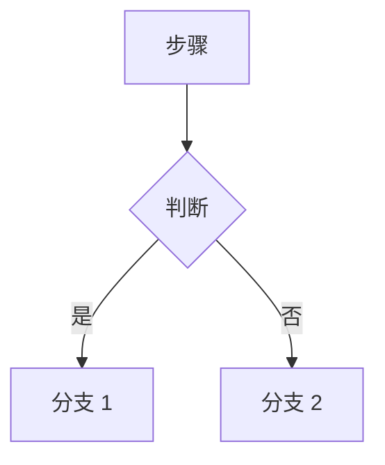
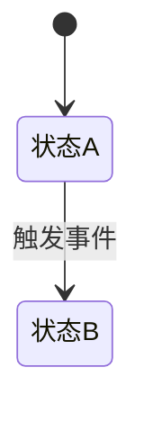
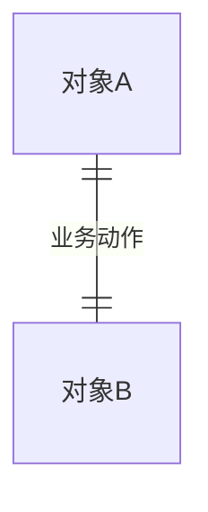

<!--
标准需求文档模板 · 空白骨架
用法：复制本文件，按章节填写；本文件中的 HTML 注释是填写提示，产出文档时应删除。
标注：S1 表单可校验 ｜ S2 骨架+自然语言 ｜ S3 自由文本 ｜ S4 图与素材（用【材料名称】占位）
文档粒度：标准=新模块/新功能/跨系统；轻量=优化项/配置变更/小需求，第 1 章以 1.5 功能清单为主，流程/数据有变化的保留最小 1.3/1.4，第 4 章直接声明不涉及
-->

# 【产品线+年月】需求名称 · 产品需求说明书

| 需求编号 |  |
|:--|:--|
| 需求名称 |  |
| 产品线 |  |
| 版本 | v1.0 |
| 作者 |  |

## 1. 需求说明

### 1.1 背景与目标

<!-- S3：现状/痛点/目标写事实与业务语言，各给一个数字；材料里已有的「本期不做/下期」内容，在目标后一段话带过，不单列章节 -->

**现状**：
（含量化：日均 / 总量 / 频次，如"财务逐笔手工开票，日均约 100 笔"）

**业务痛点**：
（含影响面：X% 的 XX 受影响 / 每月约 Y 次出错 / 涉及 Z 个岗位）

**本期目标**：
（给基线→目标值+期限，如"单批次开票耗时从 15 分钟降到 3 分钟以内"）

**方案取舍**：（可选）

### 1.2 术语定义

<!-- S1+S2：定义写三件事（是什么+怎么形成+与相近概念区别）；无新术语写「本需求不涉及新术语」 -->

| 术语 | 定义 | 别称/简称 |
|:--|:--|:--|
|  |  |  |

### 1.3 业务流程

<!-- S3+S4：业务流程图原图优先（ 嵌入），没有原图用 mermaid flowchart 画主干（跨角色/系统用 subgraph 当泳道）；含状态机时加状态流转图 stateDiagram-v2，状态取值与流转条件须与第 3 章一致；1.3 只画跨功能端到端主干，单功能内部流程放 2.x.2 -->

**流程描述**：
（主干一句话 + 参与角色/系统 + 关键分支与异常走向；不逐节点复述下图）

**业务流程图**：
（原文档/用户有图 → `` 嵌入；没有 → mermaid 画主干）

**状态流转图**：（可选：含状态机时才画）

### 1.4 数据视图

<!-- S3+S4：概念模型条件必填——有新增/变更业务对象时用 mermaid erDiagram 画（实体名=1.2 术语，关系=业务动词，基数=业务规则），图下配一句「主链+分支」；确无则写「本次需求不涉及新业务实体」。数据流向涉及来源/去向变化时必填，简单场景一句话，跨系统/落库/线下用结构化小表；不涉及则写「本次需求不涉及数据流向变化」 -->

**概念模型**：
（有新增/变更业务对象时必画；确无则写「本次需求不涉及新业务实体」）

主链：……；分支：……（只写流转主干，不列属性/字段）

**数据流向**：（如涉及）

| 数据 | 来源（系统/角色/线下） | 数据形态变化 | 去向 | 流转类型 | 是否落库 | 频率 | 失败处理 |
|:--|:--|:--|:--|:--|:--|:--|:--|
|  |  |  |  |  |  |  |  |

### 1.5 功能清单

<!-- S1：与第 2 章一一对应 -->

| 编号 | 模块 | 功能点 | 功能概述 | 优先级 | 菜单路径 |
|:--|:--|:--|:--|:--|:--|
| F01 |  |  |  | P0 |  |

## 2. 功能说明

<!-- 每个功能一节，标题 2.x 功能名称；复制本小节骨架 -->

### 2.1 功能名称

> 对应功能清单：F01

#### 2.1.1 功能说明

<!-- S2 六要素：某要素不适用时写「不适用」+理由（多个不适用可合并一行），不留空；可判定的校验/枚举/计算登记到第 3 章 -->

**触发入口**：

**前置条件**：

**操作步骤**：
1. 用户……，系统……

**处理逻辑**：

**后置结果**：

**异常与提示**：
- 情况 → 系统行为 + 提示原话（「……」）

#### 2.1.2 流程描述

<!-- S4：图片文件已提取的直接  嵌入，alt 写图名；没有图片文件才保留【流程图】占位并写清位置。只画本功能内部流程，跨功能端到端主干在 1.3，不重复画 -->

【流程图】

**说明**：

#### 2.1.3 输入/输出

<!-- S2 表：枚举列全量；字段叫法与 1.2 术语一致 -->

| 字段 | 类型 | 必输 | 取值/枚举 | 校验与提示 |
|:--|:--|:--|:--|:--|
|  |  |  |  |  |

#### 2.1.4 界面布局与交互

<!-- S4+S2：图片文件已提取的直接  嵌入，alt 写页面名；没有图片文件才保留【原型图】占位并写清位置；不允许只写「见原型」 -->

【原型图】

**交互细节**：
- 按钮禁用条件：……
- 校验时机（提交时/失焦时）：……
- UI 状态：加载中 / 空数据 / 操作失败 / 成功分别显示什么
- 数据规模：列表预计多少条，是否分页或懒加载
- 异步操作：提交/等待期间用户看到什么，失败后能否重试
- 样式与文案变化：……

#### 2.1.5 验收要点（可选）

<!-- S2：写能被验证的句子 -->

1. 

## 3. 业务规则

<!-- S1+S2：全文集中；一条一事；可判定；过滤条件与规则正文分离；空白过滤=全量校验 -->
<!-- 类别 ∈ {非空与存在性, 取值范围, 条件约束, 枚举取值, 计算口径, 唯一性} -->

| 编号 | 适用功能 | 类别 | 业务规则 | 过滤条件 | 触发动作与提示 |
|:--|:--|:--|:--|:--|:--|
| R01 |  |  |  |  |  |

## 4. 非功能需求（如涉及）

<!-- S2：不涉及则写「本次需求不涉及非功能要求」 -->

| 类别 | 要求 | 验证方式 | 说明 |
|:--|:--|:--|:--|
|  |  |  |  |

## 5. 备注说明

### 5.1 评审记录

| 日期 | 评审人 | 评审意见 | 结论 |
|:--|:--|:--|:--|
|  |  |  |  |

### 5.2 变更记录

| 日期 | 提出人 | 变更原因 | 变更内容 |
|:--|:--|:--|:--|
|  |  |  |  |
