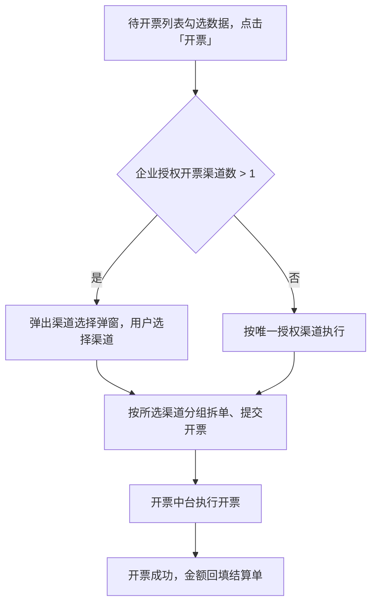
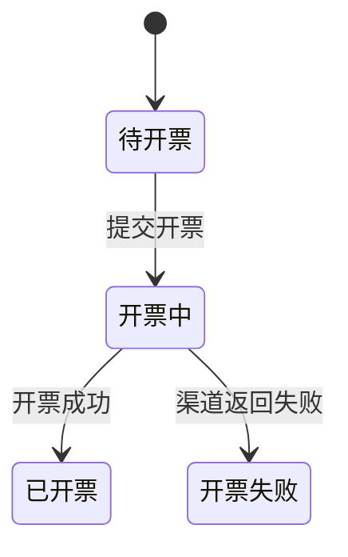
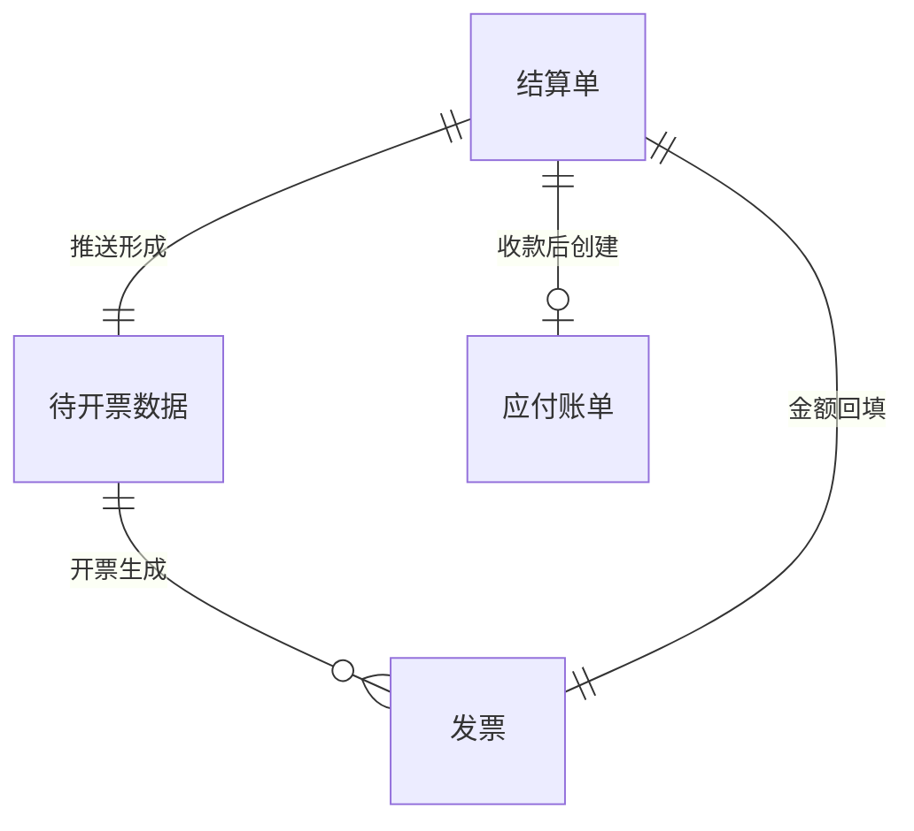
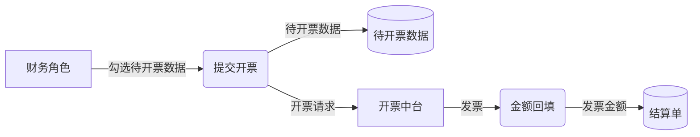

# 标准需求文档模板（规范解释版）

> 版本：v0.1 ｜ 配套：`assets/空白模板.md`（可直接套用的空白骨架）
> 技能输出以本模板为唯一基准。
> 定位：本模板是"领域约定"，用固定章节与骨架落实需求工程标准的通用特性（ISO/IEC/IEEE 29148、INCOSE、NASA：无歧义 / 完整 / 一致 / 可验证 / 单一 / 可追溯 / 可行 / 必要）；「功能六要素」等是本模板的字段约定，不是标准原文的固定结构。

## 目录

- [0. 设计原则](#0-设计原则)
- [1. 标注与约定](#1-标注与约定)
- [2. 文档头](#2-文档头)
- [3. 章节详解](#3-章节详解)
  - [3.1 需求说明（第 1 章）](#31-需求说明第-1-章)
  - [3.2 功能说明（第 2 章）](#32-功能说明第-2-章)
  - [3.3 业务规则（第 3 章）](#33-业务规则第-3-章)
  - [3.4 非功能需求（第 4 章，如涉及）](#34-非功能需求第-4-章如涉及)
  - [3.5 备注说明（第 5 章）](#35-备注说明第-5-章)
- [4. 写作总则](#4-写作总则)
- [5. 提交前自检](#5-提交前自检)

---

## 0. 设计原则

1. **贴着现行习惯改**。骨架沿用常见的需求说明书结构（需求说明 / 功能说明 / 备注说明），章节顺序按高频顺序排；不发明产品看不懂的新结构。
2. **能枚举的用表，要论述的用文**。功能清单、术语、输入输出、业务规则、评审、变更一律表格；背景、痛点、方案取舍保留自然语言。
3. **可校验的给字段**。优先级、版本信息、功能编号与规则编号做成字段，不再靠删除线与加粗标签表达。
4. **不强行要求模板之外的内容**。原型图用嵌入或占位承载；业务流程图、状态流转图、概念模型与数据流图（如涉及）没有原图时用 mermaid 画；术语与业务规则是需求本身就该写清的内容，把它们放到固定的位置。

## 1. 标注与约定

### 1.1 内容分档（决定谁写、怎么写）

| 标注 | 含义 | 处理方式 |
|:--|:--|:--|
| S1 表单 | 内容离散可枚举 | 填表，可校验必填与枚举 |
| S2 骨架 | 固定字段 + 自然语言正文 | 按骨架草拟，人工改定 |
| S3 自由文本 | 论述性内容 | 只给结构提示与字数参考，不代写 |
| S4 图与素材 | 图与素材占位 | 用【材料名称】占位或挂图，不做识别 |

### 1.2 占位与缺口约定

- **【材料名称】**：需要补充的图的占位，如 `【流程图】`、`【原型图】`。括号里只写材料名称，图名与位置写在后面；必须说清"去哪儿能找到"，不允许只写「见原型」。
- **图片文件已存在时不用占位**：docx 转换会提取图片到 `<文档名>.assets/` 目录，直接用 `` 嵌入显示；只有文字说明、没有图片文件的才保留占位。
- **缺口处理**：信息不足时先与用户确认；未确认的实现不写入正文，也不在文档中留未决标记；未决事项只在交付说明（未决缺口）里列出。
- **编号**：功能清单 `F01、F02…`；业务规则 `R01、R02…`；正文引用规则写「校验见 R05」。

## 2. 文档头

```markdown
# 【产品线+年月】需求名称 · 产品需求说明书

| 需求编号 | 【如：RFN20260623003】 |
|:--|:--|
| 需求名称 | |
| 产品线 | 产品线 A / 产品线 B / 运营后台 … |
| 版本 | v1.0 |
| 作者 | |
```

**标准与轻量**：标准 = 新模块、新功能、跨系统需求（默认）；轻量 = 优化项、配置变更、小需求。轻量模式下，第 1 章以 1.5 功能清单为主，其余节写「本次需求不涉及」；确涉及流程或数据变化的，保留最小 1.3/1.4（主干一行 + 变更点），无变化才声明不涉及；第 4 章非功能需求直接声明不涉及；第 2、3、5 章照常完整填写。轻量不是降质——省的是无关章节，不是功能说明与业务规则的质量。

## 3. 章节详解

### 3.1 需求说明（第 1 章）

#### 1.1 背景与目标 ｜ S3 + 字段

```markdown
**现状**：（现在业务怎么做、系统现状是什么；含量化：日均/总量/频次）
**业务痛点**：（为什么现状不行，不写方案；含影响面：X% 的 XX / 每月约 Y 次）
**本期目标**：（做完之后达到什么状态，可验证；给基线→目标值+期限；本期范围即在此说明）
**方案取舍**：（可选：为什么选这个方案，放弃过什么方案）
```

- 「本期目标」同时承载本期范围；材料中已有"本期不做 / 下期"内容的，在目标后以一段话带过，不单列章节或字段；材料里没有的不要追着补。
- 现状、痛点、目标各写一个数字：现状写日均/总量/频次；痛点写影响面（多少用户、每月多少次）；目标写基线→目标值+期限。数字必须来自材料，材料里没有的进「未决缺口」，不编。
- 痛点写业务语言，不写"效率低"这类空话——写"财务逐笔手工开票，一天约 X 笔，错开风险高"这种能被引用的事实。

#### 1.2 术语定义 ｜ S1 表 + S2 定义

```markdown
| 术语 | 定义 | 别称/简称 |
|:--|:--|:--|
| 可用额度 | 授信额度中尚未占用、当前仍可使用的金额，随放款扣减、随还款恢复。 | 可用授信 |
```

- **定义写三件事**：它是什么 + 怎么形成/怎么变 + 与相近概念怎么区分；用完整句子，不用术语解释术语，不循环定义。别称只能进「别称/简称」列，禁止用别称定义术语本身（如「中国工商银行 = 工行提供的开票渠道」是循环定义）。
- **收录范围**：本需求新出现的业务名词、跨系统共用概念、容易叫法不一的词。纯技术名词（接口、缓存）、页面元素名（按钮、弹窗）、无歧义通用词不收。
- **别称/简称**：同一概念的其他叫法（正文里出现过的口语化叫法填这里），便于全文统一。
- 如确无新术语，写「本需求不涉及新术语」，不要留空。
- **提取按 5 步走**：划名词 → 并叫法 → 定取舍 → 写定义 → 回指统一；判定与反例见 `references/术语与规则写法.md` §1。

#### 1.3 业务流程 ｜ S3 + S4

````markdown
**流程描述**（主干一句话 + 参与角色/系统 + 关键分支与异常走向；不逐节点复述下图）
- 主干：……
- 参与角色/系统：……（跨系统交接点：……）
- 关键分支与异常走向：……

**业务流程图**（原文档/用户有图 → 嵌入原图；没有 → mermaid 画主干）


**状态流转图**（可选：需求含状态机时才画；状态取值与流转条件须与第 3 章业务规则一致）

````

- **1.3 与 2.x.2 的分工**：1.3 只画跨功能、跨系统、跨角色的端到端主干；单个功能内部的流程放 2.x.2，同一流程不在两处重画。
- **流程描述只补图表达不了的**：主干一句话 + 参与角色/系统 + 跨系统交接点 + 关键分支与异常走向；不逐节点复述图（顺序与分支由图承载）。
- **业务流程图优先级**：原文档或用户提供的图 → 直接 `` 嵌入，不重画；都没有 → 用 mermaid `flowchart` 画主干流程，判断分支只画影响业务走向的关键点；跨角色/跨系统用 `subgraph` 当泳道。
- **状态流转图**：仅当需求涉及状态机时画（mermaid `stateDiagram-v2`）；状态取值、流转条件、终态与第 3 章规则一致，图内不写接口/表名。
- **mermaid 纪律**：节点文案用业务语言（页面 / 动作 / 状态 / 角色），不出现接口、服务名等实现细节；图上方给图名（如「业务流程图（主干）」「状态流转图」）。

#### 1.4 数据视图 ｜ S3 + S4

````markdown
**概念模型**（有新增/变更业务对象时必画；确无则写「本次需求不涉及新业务实体」）

主链：……；分支：……（只写流转主干，不列属性/字段）

**数据流图**（本需求涉及数据在角色/系统/存储间流转时必画；完全不涉及数据流转时才写「本次需求不涉及数据流图」并给一句理由）

主干：……（一句话说清 来源 → 去向 与跨系统交接点；频率/失败处理如涉及一并写）
````

- **概念模型**：用 mermaid `erDiagram` 画需求涉及的业务对象及其关系；**实体名 = 1.2 术语**，关系标签写业务动作（推送形成 / 开票生成 / 回填 / 创建），基数按业务事实判断（一笔 X 对应几笔 Y），不写表名、外键（那是技术方案）。
- **图下配一句「主链 + 分支」**：只写流转主干（哪几个对象是主链、主线外有哪些分支），不列属性、枚举、字段清单。
- **概念模型条件必填**：新增业务对象、或改变了对象之间的关系（含既有对象的新关系、关系基数变化）时必画；仅当既不新增对象也不改关系（纯字段/文案/界面调整）时才写「本次需求不涉及新业务实体」并给理由，不留空。
- **画法按 6 步走**：列对象 → 连关系 → 定基数 → 定主链/分支 → 画图 → 复核；细则见 `references/术语与规则写法.md` §3。
- **数据流图**：用 mermaid `flowchart` 画业务层数据流图，四类元素固定形状——外部实体（角色/外部系统/线下）用方框 `[]`、加工（业务环节，动词短语）用圆角 `()`、数据存储（业务台账/业务对象）用圆柱 `[()]`、数据流用带箭头连线并标注所流的数据。节点名 = 1.2 术语，与概念模型叫法一致；只画业务语言，不写接口、表名、网段。
- **数据流合法**：数据流在加工之间流动，或 外部实体 → 加工、加工 → 数据存储；外部实体不直连数据存储，数据存储不连数据存储；每个加工至少一进一出，无只有输入或只有输出的孤立节点。
- **一张主干图**：默认画端到端主干（数据从哪来 → 经哪些环节 → 到哪去）；环节多时按加工拆子图，单图加工控制在 5–9 个；是否落库、跨系统交接点在图里体现，频率与失败处理写进图下说明。
- **数据流图条件必填**：只要本需求涉及数据在角色 / 外部系统 / 数据存储之间流转（新流向、落库、跨系统提交、回填等）就必画——**复用现有系统/接口不算「不涉及」**；仅当整篇需求完全不涉及数据流转（纯展示、纯字段或文案调整）时才写「本次需求不涉及数据流图」，并给一句理由。
- 转 Word 时 mermaid 保留为代码块；评审材料需要渲染图时，用 mermaid-cli 转 PNG 后嵌入。

#### 1.5 功能清单 ｜ S1 表

```markdown
| 编号 | 模块 | 功能点 | 功能概述 | 优先级 | 菜单路径 |
|:--|:--|:--|:--|:--|:--|
| F01 | 中台管理-开票管理 | 待开票列表优化 | 支持按销售方分组拆单后批量开票 | P0 | 产品线 A-中台管理-开票管理-待开票列表 |
```

- **功能清单与第 2 章一一对应**：清单里的每个功能点，在第 2 章都有一个同名的 2.x 小节；反之亦然。
- 优先级用 P0（必做）/ P1（重要）/ P2（优化）。
- 已有系统内的功能路径写「菜单路径」，便于研发与测试定位。

### 3.2 功能说明（第 2 章）

每个功能一节，标题为 `2.x 功能名称`（与功能清单 F 编号对应，正文首行注明 `> 对应功能清单：F01`）。

#### 2.x.1 功能说明 ｜ S2 六要素

```markdown
**触发入口**：（用户从哪进来、点什么触发）
**前置条件**：（需要先满足什么：权限、数据、开关、上游状态）
**操作步骤**：
1. 用户……，系统……
2. ……
**处理逻辑**：（系统怎么处理：分组、计算、流转、调用）
**后置结果**：（完成后生成/变更了什么：数据、状态、通知）
**异常与提示**：
- 情况 1 → 系统行为 + 提示原话（「……」）
- 情况 2 → ……
```

- 六要素是"完整"的最小骨架；某要素确实不适用时，写「不适用」并给一句理由，不要留空；多个要素同时不适用时合并为一行（如「**前置条件/操作步骤/后置结果/异常与提示**：均不适用——列表展示变更」）。
- **可判定的校验、枚举、计算口径不在本节展开**，登记到第 3 章业务规则表；正文可引用「校验见 R05」。
- 操作步骤用"用户做什么 → 系统做什么"的句式；避免大段叙述。
- 异常与提示要写**提示原话**，不写"给出相应提示"。

#### 2.x.2 流程描述 ｜ S4

```markdown

**说明**：主干为「……」，分支为「……」。
```

- 图片文件已提取时直接嵌入 ``（alt 写图名，相对路径指向 `.assets/`）；没有图片文件时改为 `【流程图】<流程名>（图名与文件位置写清）` 占位。
- 只画本功能内部的流程；跨功能、跨系统的端到端主干在 1.3，同一流程不在两处重画。
- 简单功能可省略；涉及跳转、多角色、状态的流程必须给图或分步文字。

#### 2.x.3 输入/输出 ｜ S2 表

```markdown
| 字段 | 类型 | 必输 | 取值/枚举 | 校验与提示 |
|:--|:--|:--|:--|:--|
| 销售方 | 下拉多选 | 是 | 往来客户中客户类型含"供应商"的数据 | 无供应商时提示：「请先维护销方开票配置」 |
```

- 输入输出要素定义、类型、长度、取值、校验与提示；枚举直接列全量取值。
- 字段叫法与 1.2 术语一致；同一字段在不同功能叫法必须相同。

#### 2.x.4 界面布局与交互 ｜ S4 + S2

```markdown

**交互细节**：
- 按钮禁用条件：……
- 校验时机（提交时/失焦时）：……
- UI 状态：加载中 / 空数据 / 操作失败 / 成功，分别显示什么
- 数据规模：列表预计多少条，是否分页或懒加载
- 异步操作：提交/等待期间用户看到什么，失败后能否重试
- 样式与文案变化：……
```

- 原型图片文件已提取时直接嵌入 ``（alt 写页面名）；没有图片文件时改为 `【原型图】<页面名称>（原型地址/文件位置）` 占位。

- **UI 状态**：每个页面/弹窗至少说清四种状态——加载中（转圈/骨架）、空数据（无数据时显示什么）、操作失败（错误提示与重试入口）、操作成功（反馈方式）。
- **数据规模**：涉及列表时写明预期条数级别（百/千/万）及是否需要分页或懒加载。
- **异步操作**：提交、导入、轮询等非即时操作，说明用户等待期间看到什么（进度、提示文案、禁止重复提交），以及失败后能否重试。

#### 2.x.5 验收要点（可选）｜ S2

用能被验证的句子写，后续可直接派生测试用例：

```markdown
1. 勾选超过 500 个待开数据点击【开票】时，系统阻断并提示「超出单批次最大可开票数量」。
2. 提交后页面每 3 秒轮询一次，全部发票到达终态后停止轮询并显示【开票完成】。
```

### 3.3 业务规则（第 3 章）

全篇所有"什么情况算对、什么情况算错"集中在此。**第一用途是上线后的数据质量检查**：每条规则要能写成一条检查脚本/SQL 在数据里跑出违规记录；评审核对、研发建约束是中间用途。类别按六类：**非空与存在性 / 取值范围 / 条件约束 / 枚举取值 / 计算口径 / 唯一性**——每类对应一类数据检查。确无数据层规则时写「本次需求不涉及业务规则」，不硬凑。

```markdown
| 编号 | 适用功能 | 类别 | 业务规则 | 过滤条件 | 触发动作与提示 |
|:--|:--|:--|:--|:--|:--|
| R01 | F01 待开票列表优化 | 取值范围 | 一次性最多勾选 500 个待开数据（车次） | 全量 | 阻断，提示「超出单批次最大可开票数量勾选车次数量」 |
| R02 | F03 授信审批 | 条件约束 | 授信结果=通过时，授信合同号不能为空 | 排除测试数据 | 阻断，提示「合同号不能为空」 |
| R03 | F05 采购结算 | 计算口径 | 结算金额 = 过磅重量 × 单价 + 运费 | 排除测试数据 | 自动计算 |
```

写法要求：

1. **可判定**：写完后自问"什么数据能证明它违规？"。✗「数据要准确及时」；✓「放款日期晚于授信开始日期」。
2. **一条规则写一件事**：出现"且/和"的复合约束默认拆条（"金额 ≥ 0 且 ≤ 授信额度"拆两条），便于分别校验、分别停用。
3. **过滤条件不混入规则正文**：规则写「采集价 > 0」，过滤条件写「排除商品名称含测试的记录」；过滤条件空白 = 全量校验（含义明确，不需要补写）。
4. **枚举写全**：直接列举或写区间，如「状态 ∈ {待审核, 已通过, 已驳回}」「账期 ≤ 365 天」。
5. **计算口径照抄**：文档有公式的原文照抄；只提了口径没给公式的，先与业务确认后补写（确认不了的在交付说明（未决缺口）里列出）。
6. **触发动作与提示**：写清是阻断 / 报错 / 默认值 / 自动计算，并给提示原话。
7. 引用的字段叫法必须与 1.2 术语一致。
8. **宁缺毋滥**：只收四条门槛全过的规则——落在数据层、违规有业务后果、可判定、拿不准不收。页面交互约束（按钮禁用、样式、校验时机、弹窗行为、Tab 切换）不进本表，归 2.x.4 交互细节。

**提取按 6 步走**：扫信号 → 过门槛 → 拆条 → 分离 → 补动作 → 归类编号；细则见 `references/术语与规则写法.md` §2。

**数据层约束不留在功能说明**：凡能写成「字段 X 满足条件 Y」的可判定条件（如「开票状态 = 待开票」「金额 > 0」），一律进本表；功能说明里只用「校验见 Rxx」引用，不要只在 2.x 的「异常与提示」里描述。

### 3.4 非功能需求（第 4 章，如涉及）

如涉及性能、安全、权限、审计、兼容性等要求，集中列一节；不涉及则整章写「本次需求不涉及非功能要求」。

```markdown
| 类别 | 要求 | 验证方式 | 说明 |
|:--|:--|:--|:--|
| 性能 | 单批次开票 ≤ 200 张；轮询间隔 3 秒 | 测试 | 超过 200 张时阻断 |
| 安全与权限 | 仅财务角色可提交开票；开票信息按角色脱敏 | 演示 | … |
```

- 能量化就量化（数值 + 单位 + 条件）；不能量化写决策要素（并发量级、监管要求）。

### 3.5 备注说明（第 5 章）

#### 5.1 评审记录 ｜ S1

```markdown
| 日期 | 评审人 | 评审意见 | 结论 |
|:--|:--|:--|:--|
| 2026-06-12 | 张三、李四 | 按意见修改后通过 | 通过 |
```

#### 5.2 变更记录 ｜ S1

```markdown
| 日期 | 提出人 | 变更原因 | 变更内容 |
|:--|:--|:--|:--|
| 2026-06-15 | 王五 | 合规要求 | 单批次上限由 500 调整为 300 |
```

## 4. 写作总则

1. **短句 + 编号**。一个编号一件事；不用长段落。
2. **删形容词与副词**。"快速、友好、灵活、尽量、较大、必要时、视情况"一律替换为具体数值或条件。
3. **数值、状态、文案写实**。金额给边界，状态给全量取值与流转条件，提示给原话。
4. **术语全文一个叫法**。同一概念在全文（含功能清单、规则、原型标注）用同一标准叫法；别称进 1.2 的别称列。
5. **不写实现细节**。表结构、接口协议、框架选型是研发技术方案的事；需求写"什么、为什么、什么算对"。
6. **信息不足先确认**。与用户对话确认后写入；未确认的实现不写入正文，也不在文档中留未决标记。
7. **编号兼容三种写法**：本模板统一用 `1. / 1.1 / 1.1.1` 手工编号；转 Word 时套用标题样式；正文中的加粗短标签按本模板的固定字段名书写。
8. **篇幅预算（默认值，非硬门槛）**。优化模式下默认把总篇幅控制在源文档的 0.8～1.2 倍——这是同时防膨胀与漏内容的体检带；源文档本身过简或过密时，按内容完整度判断并在变更说明里注明理由。骨架性文字（字段标签、不适用声明、过渡句）从简，同一信息不重复出现。超预算时按「删重复 → 合并不适用声明 → 聚合同类小节 → 精简新增描述」的顺序压缩，事实、数值、提示原话不动。

## 5. 提交前自检

- [ ] 功能清单与第 2 章功能说明一一对应，无遗漏、无多余；
- [ ] 每个功能的六个要素齐全（或已写明"不适用"及理由；多个不适用已合并为一行）；
- [ ] 术语表无空转（无内容则已写"本需求不涉及新术语"）；定义是完整句子；
- [ ] 业务规则全部可判定、一条一事、过滤条件与规则正文分离；
- [ ] 枚举与状态取值写全，状态流转条件明确；
- [ ] 输入输出字段的类型、必输、取值、校验与提示齐全；
- [ ] 全文无"快速、友好、灵活、尽量、必要时"等模糊表述；
- [ ] 提示文案为原话；
- [ ] S3 自由文本（背景/痛点/目标/方案取舍等）已按 `references/表达规范.md` 过一遍：无模板句式壳与 AI 腔、段落节奏自然，且未改动术语、数值、提示原话；
- [ ] 篇幅：优化模式下总字数默认在源文档的 0.8～1.2 倍（`check_prd.py --baseline` 核对）；偏离时已按内容完整度判断并说明理由；
- [ ] 本期范围在「本期目标」中说清（如涉及）；
- [ ] 图与素材：有图片文件的已用 `` 嵌入，无文件的占位均写清材料位置（不允许只写"见原型"）；
- [ ] 1.3 业务流程有业务流程图（原图嵌入或 mermaid），含状态机时有状态流转图；节点/角色叫法与 1.2 术语一致，无实现细节；
- [ ] 1.4 数据视图：有新增业务对象时给了概念模型（erDiagram）与「主链 + 分支」描述；涉及数据来源/去向变化时给了数据流图（flowchart，四类元素齐全、数据流合法、命名一致）或已声明「不涉及数据流图」；
- [ ] 所有表格均含 GFM 分隔行（含 `:--` 的那一行）；缺则导出 Word 时表格会塌成一行；
- [ ] 无 XXX、填写提示残留；未决事项已与用户确认，文档中无未决标记；
- [ ] 无字段标签无值（空壳）；表格无整行空白未填写（`check_prd.py` HOLLOW-01 / TBL-02）；
- [ ] 评审记录、变更记录已登记。
